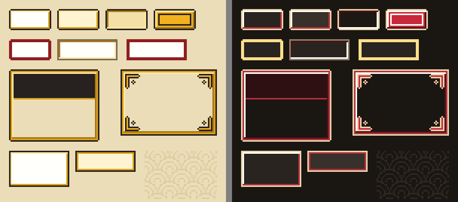
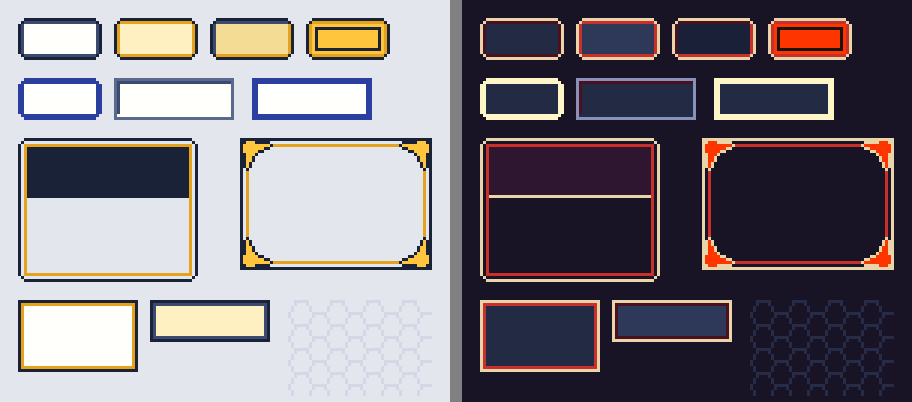
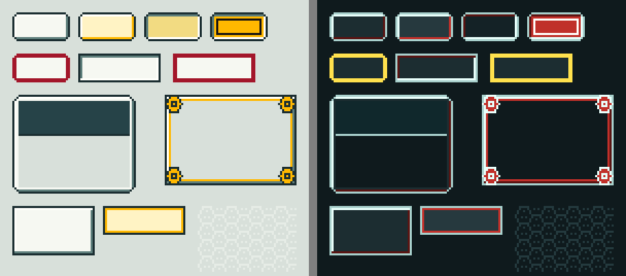
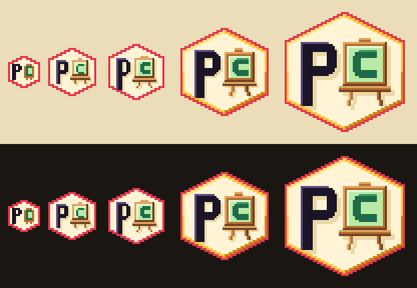

# PixelArt Creator style guide

This guide describes the visual identity of PixelArt Creator: the styles of the
application chrome, the colour roles every style is built from, the templates
that draw frames, ornaments and patterns, the rules that keep them legible and
crisp, the Kikko Badge logo, and where all of it comes from. It is written for
contributors who add a style, change a colour or draw a template.

Everything here is read from the files that ship with the application. If this
guide and the data ever disagree, the data wins and the guide is the bug.

| What | Where |
|---|---|
| Style data (index, contrast pairs, per style roles and templates) | `pixelart_creator/themes/` |
| Logo masters | `pixelart_creator/icons/app/logo-master-{16,24,32,48,64}.png` |
| Nifen Art typeface and its font log | `pixelart_creator/fonts/` |
| Contrast check | `scripts/check_theme_contrast.py` |

## 1. The three styles

A style is a directory under `pixelart_creator/themes/` holding a role map for
every mode (Light and Dark), the template grids and a small `templates.json`.
The file `pixelart_creator/themes/index.json` lists the styles, the default
style and the default mode.

| Style | Id | Status | In one line |
|---|---|---|---|
| Washi & Kintsugi | `washi-kintsugi` | data committed; canonical (default style, default mode Light) | Quiet paper-and-lacquer chrome: gold seams in Light, red seams in Dark, solid axis-aligned rings, a 1 px nick on docked child frames, a kintsugi bracket ornament and a seigaiha (wave) pattern. |
| Edo Night | `edo-night` | data committed | A light line on a dark field with a double rule: amber in Light, vermilion in Dark, rounded docked child frames, a tomoe-hook ornament and a kikko (hexagon lattice) pattern. |
| Arcade Kikko | `arcade-kikko` | data committed | Bright arcade-hardware chrome on a teal-grey field: gold in Light, red in Dark, three-ring bevelled frames, a 45 degree chamfer on docked child frames, a kikko hex-stud ornament and a bishamon kikko pattern (a hexagon lattice with a three-dot cluster in every hexagon). |

Rules that hold for every style:

- Every style carries exactly the same 24 role keys in both modes. The contrast
  check refuses a catalogue in which one role map has a key another lacks.
- Every style carries the same template names, so one sprite builder serves all.
- Gold and red are fills, lines and ornaments. They are never used as small text
  on a ground that fails the text floor; the only gold or red text is the bold
  dock title on its dark `title_fill` band.
- The light source is the top left in every bevel: pale tones on the top and
  left rings, dark tones on the bottom and right.

The three styles drawn from their committed data, Light on the left and Dark
on the right (each figure is built by composing the committed templates at 3x,
with no text, so only the art is shown):







Reading each panel, top to bottom: the four button states (normal, hover,
pressed, checked); a focused button and a plain and a focused field; a dock
title plate over its body and a dialog frame with its four ornaments; a menu, a
tooltip and the pattern tile in its container.

## 2. Colour roles

A role is a name for what a colour is for. Templates and stylesheets refer to
roles; only `roles.json` holds colour values. There are 24 roles.

**Colour syntax.** A colour is `#RRGGBB` (opaque) or `#AARRGGBB` with **alpha
first**, which is how Qt reads an eight-digit value. `canvas_grid` is the only
role that is translucent; it is composited over the checker colour it lies on
before it is measured. Art pixels are never translucent: alpha in every
template render is 0 or 255.

| # | Role key | What it colours | Washi light | Washi dark | Edo light | Edo dark | Arcade light | Arcade dark |
|---|---|---|---|---|---|---|---|---|
| 1 | `background` | Window ground, dock bodies, dialog interiors; the only ground a pattern is drawn on. | `#EBDDB8` | `#1A1612` | `#E4E6EE` | `#181425` | `#D8E0DA` | `#0F1A1D` |
| 2 | `surface` | Fill of lists, fields, menus, tooltips, tabs and unpressed buttons. | `#FFFFFB` | `#2A2420` | `#FFFFFB` | `#232B44` | `#F6F8F2` | `#1C2D31` |
| 3 | `text` | Body text and menu text on `background`, `surface`, `hover`, `pressed` and `pattern`. | `#27221F` | `#EFE2C4` | `#192236` | `#FFFFFB` | `#171412` | `#FFFFFB` |
| 4 | `accent` | Selected-state fill (checked buttons, selected tabs, selected rows). | `#F2B01E` | `#C8283A` | `#FFC53D` | `#FF3500` | `#FFB800` | `#C0302A` |
| 5 | `accent_text` | Text on `accent`, and the 1 px selected-state cue ring inside an accent fill. | `#27221F` | `#FFFFFB` | `#192236` | `#171412` | `#171412` | `#FFFFFB` |
| 6 | `border` | The 1 px outline of a plain widget on `background` or `surface`. | `#7A6A55` | `#8F8068` | `#5B6A8C` | `#8791BA` | `#4F6B6A` | `#7FA3A0` |
| 7 | `focus` | The keyboard-focus overlay ring (2 art pixels) and nothing else. | `#8F1D21` | `#FFE08A` | `#2A3F9F` | `#FFF6C8` | `#A3162A` | `#FFE14D` |
| 8 | `disabled_text` | Text of a disabled control. | `#9A8F7E` | `#7A6F60` | `#8E96AA` | `#6E7596` | `#8A9A98` | `#6B8582` |
| 9 | `canvas_checker_light` | Light squares of the transparency checker behind the document. | `#FFFFFB` | `#4A423A` | `#FFFFFF` | `#3E4767` | `#FFFFFF` | `#3A5054` |
| 10 | `canvas_checker_dark` | Dark squares of the transparency checker behind the document. | `#E3D7B8` | `#3A332D` | `#D5D8E4` | `#2E3652` | `#CBD6D0` | `#2A3C40` |
| 11 | `canvas_grid` | Pixel-grid lines drawn over the document. The only translucent role (`#AARRGGBB`). | `#70524A3A` | `#80C8B890` | `#70192236` | `#80B4BCDC` | `#70264348` | `#80A8C8C4` |
| 12 | `canvas_workspace` | The flat colour around the document; never patterned. | `#D6C8A2` | `#120F0C` | `#C9CDDC` | `#100C1B` | `#BCC9C3` | `#0A1214` |
| 13 | `canvas_border` | The edge of the document against the workspace. | `#3A2E24` | `#C8B890` | `#192236` | `#B4BCDC` | `#1B2E31` | `#A8C8C4` |
| 14 | `frame_edge` | Outermost line of every frame and popup. | `#2A211B` | `#EAD4AA` | `#192236` | `#EAD4AA` | `#1B2E31` | `#A8D0CC` |
| 15 | `frame_hi` | Light bevel tone: the top and left of bevelled frames and buttons, the bottom and right of a sunken field. | `#FFE9A3` | `#FFFFFB` | `#FFFFFB` | `#FFFFFB` | `#FFFFFB` | `#E8FFFB` |
| 16 | `frame_mid` | Mid-tone ring: the seam ring of docks and dialogs and the closing line of buttons, menus and tooltips. Gold in Light, red in Dark. | `#D9A01A` | `#B03040` | `#E5A21D` | `#C9302C` | `#FFB800` | `#C0302A` |
| 17 | `frame_lo` | Shaded bevel tone: the bottom and right of bevelled frames, the top and left of a sunken field, and the button ring of Edo Night. | `#A8791A` | `#4A1218` | `#3B4A70` | `#4A1220` | `#5E7F7C` | `#5A1412` |
| 18 | `title_fill` | Band of a dock title plate and of a dialog heading row. | `#27221F` | `#2E0F12` | `#192236` | `#2E1630` | `#264348` | `#10282C` |
| 19 | `title_text` | Dock title text, title-bar glyphs (close, float) and the heading text. | `#F6D878` | `#EAD4AA` | `#FFD66B` | `#EAD4AA` | `#FFD54A` | `#FFFFFB` |
| 20 | `ornament` | Fill of the corner ornament. | `#F2B01E` | `#C8283A` | `#FFC53D` | `#FF3500` | `#FFB800` | `#C0302A` |
| 21 | `ornament_outline` | Outline of the corner ornament. | `#27221F` | `#EAD4AA` | `#192236` | `#EAD4AA` | `#1B2E31` | `#E8FFFB` |
| 22 | `pattern` | Ink of the pattern tile, painted over `background`. | `#DCCDA2` | `#2E2822` | `#D4D8E6` | `#262C48` | `#E6ECE6` | `#243A3E` |
| 23 | `hover` | Fill of a hovered button and of a tooltip. | `#FFF4D2` | `#38302A` | `#FFF0C2` | `#2E3858` | `#FFF3C4` | `#26393E` |
| 24 | `pressed` | Fill of a pressed button. | `#F3E0A6` | `#1E1814` | `#F5DC94` | `#1A2038` | `#F2DB82` | `#142226` |

## 3. Contrast floors and the declared pairs

Two floors apply, both from WCAG 2.x:

- **Text: 4.5:1.** Body text, title text and the text on an accent fill.
- **Components and focus: 3.0:1.** Borders, frame lines, ornament outlines, the
  document edge and the keyboard-focus ring.

`pixelart_creator/themes/contrast-pairs.json` is the pair manifest. Each entry
names a foreground role, a background role, a kind (`text`, `component` or
`info`) and a note. `text` and `component` pairs are gated against their floor;
`info` pairs are measured and reported but never gate (for example the selected
fill against the unselected fill, or disabled text, which WCAG exempts).

**Derived focus pairs.** The focus pairs are not listed in the manifest. The
check composes every focusable framed control with its focus ring over each
ground, finds every role the ring actually touches (4-neighbour adjacency), and
gates `focus` against each of those roles at 3.0. In all three styles the
ring touches `accent`, `background`, `hover`, `pressed` and `surface`. A ring
that began touching a frame colour would add a gated pair automatically, and
the check refuses to pass if the ring touches nothing.

Run it from the repository root:

```
python scripts/check_theme_contrast.py
```

Measured on the committed data (every gated pair, six themes):

| Pair (foreground on background) | Kind | Floor | `washi-kintsugi/light` | `washi-kintsugi/dark` | `edo-night/light` | `edo-night/dark` | `arcade-kikko/light` | `arcade-kikko/dark` |
|---|---|---|---|---|---|---|---|---|
| `text` on `background` | text | 4.5 | 11.662 | 14.002 | 12.734 | 17.972 | 13.617 | 17.666 |
| `text` on `surface` | text | 4.5 | 15.694 | 11.917 | 15.830 | 13.961 | 17.139 | 14.260 |
| `text` on `hover` | text | 4.5 | 14.326 | 10.063 | 13.975 | 11.493 | 16.476 | 12.059 |
| `text` on `pressed` | text | 4.5 | 12.004 | 13.668 | 11.748 | 16.021 | 13.299 | 16.283 |
| `text` on `pattern` | text | 4.5 | 9.962 | 11.329 | 11.156 | 13.636 | 15.286 | 11.972 |
| `accent_text` on `accent` | text | 4.5 | 8.244 | 5.483 | 10.054 | 5.031 | 10.573 | 5.666 |
| `title_text` on `title_fill` | text | 4.5 | 11.246 | 12.149 | 11.397 | 11.382 | 7.514 | 15.382 |
| `border` on `background` | component | 3 | 3.872 | 4.673 | 4.338 | 5.825 | 4.280 | 6.450 |
| `border` on `surface` | component | 3 | 5.211 | 3.977 | 5.392 | 4.525 | 5.387 | 5.207 |
| `frame_edge` on `background` | component | 3 | 11.689 | 12.417 | 12.734 | 12.437 | 10.524 | 10.591 |
| `frame_edge` on `surface` | component | 3 | 15.730 | 10.568 | 15.830 | 9.661 | 13.246 | 8.549 |
| `ornament_outline` on `background` | component | 3 | 11.662 | 12.417 | 12.734 | 12.437 | 10.524 | 16.974 |
| `ornament_outline` on `surface` | component | 3 | 15.694 | 10.568 | 15.830 | 9.661 | 13.246 | 13.701 |
| `canvas_border` on `canvas_workspace` | component | 3 | 7.921 | 9.746 | 10.012 | 10.241 | 8.288 | 10.566 |
| `focus` on `accent` | focus | 3 | 4.652 | 4.262 | 5.760 | 3.344 | 4.475 | 4.362 |
| `focus` on `background` | focus | 3 | 6.581 | 13.946 | 7.295 | 16.531 | 5.764 | 13.602 |
| `focus` on `hover` | focus | 3 | 8.084 | 10.023 | 8.006 | 10.571 | 6.974 | 9.284 |
| `focus` on `pressed` | focus | 3 | 6.774 | 13.614 | 6.730 | 14.735 | 5.629 | 12.537 |
| `focus` on `surface` | focus | 3 | 8.856 | 11.870 | 9.068 | 12.841 | 7.255 | 10.979 |

The check prints its own controls first and refuses to pass without them: it
must fail a known failing pair (2.61:1 text), pass a known passing pair, refuse
a combination with no pairs, a role map with a missing key and a pair naming an
unknown role, and see a deliberately thin focus ring touching frame colours.
The summary lines of this run, verbatim:

```
check_theme_contrast: controls 6/6 behave as designed
== washi-kintsugi/light ==
  examined 34: declared 29 + derived focus 5; gated 19 (pass 19, fail 0); info 15; errors 0
  worst gated margin: border on background 3.872 (margin +0.872)
== washi-kintsugi/dark ==
  examined 34: declared 29 + derived focus 5; gated 19 (pass 19, fail 0); info 15; errors 0
  worst gated margin: border on surface 3.977 (margin +0.977)
== edo-night/light ==
  examined 34: declared 29 + derived focus 5; gated 19 (pass 19, fail 0); info 15; errors 0
  worst gated margin: border on background 4.338 (margin +1.338)
== edo-night/dark ==
  examined 34: declared 29 + derived focus 5; gated 19 (pass 19, fail 0); info 15; errors 0
  worst gated margin: focus on accent 3.344 (margin +0.344)
== arcade-kikko/light ==
  examined 34: declared 29 + derived focus 5; gated 19 (pass 19, fail 0); info 15; errors 0
  worst gated margin: border on background 4.280 (margin +1.280)
== arcade-kikko/dark ==
  examined 34: declared 29 + derived focus 5; gated 19 (pass 19, fail 0); info 15; errors 0
  worst gated margin: accent_text on accent 5.666 (margin +1.166)
focus pairs derived for washi-kintsugi: accent x128, background x400, hover x128, pressed x128, surface x656
focus pairs derived for edo-night: accent x128, background x400, hover x128, pressed x128, surface x656
focus pairs derived for arcade-kikko: accent x128, background x400, hover x128, pressed x128, surface x656
role-key parity: 6 role map(s) examined, 24 key(s) each, identical
TOTAL: 6 combination(s); gated pairs examined 114; pass 114, fail 0; info 90; errors 0
RESULT: PASS
```

Tightest gated pairs: `focus` on `accent` in Edo Night Dark (3.344 against 3.0)
and `accent_text` on `accent` in Edo Night Dark (5.031 against 4.5). The tightest
Arcade Kikko pairs are `border` on `background` in Light (4.280 against 3.0) and
`accent_text` on `accent` in Dark (5.666 against 4.5). Rendered
contrast (anti-aliasing, font hinting) is not measured here; every ratio is a
pure function of the role colours.

Selected state, measured by colour alone (`accent` on `surface`, info): 1.904
(Washi Light), 2.785 (Washi Dark), 1.574 (Edo Light), 3.840 (Edo Dark), 1.621
(Arcade Light), 2.517 (Arcade Dark). Five of the six are below 3.0, which is why
a selected control never relies on its fill alone. It carries a 1 px `accent_text` cue ring inside the fill, and
`accent_text` on `accent` is gated at 4.5.

## 4. Templates: grammar and legend

A template is a text grid in `<style>/templates/<name>.grid.txt`. One character
is one cell, one cell is one art pixel, and a character is a role index, never
a colour. `_` is transparent. No template file contains a colour literal (every template
file was scanned for one).

The legend (identical in all three styles, declared in `templates.json`):

| Symbol | Role | Symbol | Role |
|---|---|---|---|
| `_` | transparent | `S` | `surface` |
| `E` | `frame_edge` | `T` | `title_fill` |
| `H` | `frame_hi` | `A` | `accent` |
| `M` | `frame_mid` | `X` | `accent_text` |
| `L` | `frame_lo` | `N` | `text` |
| `G` | `background` | `I` | `title_text` |
| `B` | `border` | `V` | `hover` |
| `F` | `focus` | `R` | `pressed` |
| `O` | `ornament` | `P` | `pattern` |
| `U` | `ornament_outline` | | |

**9-slice.** A framed template carries slice insets `{left, top, right, bottom}`
in `templates.json`. The corners are copied unchanged; the edges and the centre
repeat (the Qt `border-image` mode `repeat repeat`). A template whose axis has
no middle can only be drawn at its native size on that axis. The file also
lists `border_width_px` for 1x and 2x in CSS order `[top, right, bottom, left]`;
it is derived from the slices and verified equal to slices times the scale, never
typed twice. The edge repeat of every framed template is verified seamless.

A dock title plate and its body, as examples (Washi & Kintsugi; slices
`3,3,3,1` and `3,0,3,3`). In the title plate the fourth row is the band that
repeats, and the last row is the seam:

```
dock_title          dock_body
_EEEEEEE_           EMHGGGLME
EMMMMMMME           EMLLLLLME
EMHHHHHME           EMMMMMMME
EMHTTTLME           _EEEEEEE_
EMHMMMLME
```

A checked button (slices 4) with the selected-state cue ring `X` one ring inside
the accent fill `A`:

```
_EEEEEEEE_
EHHHHHHHHE
EHAAAAAALE
EHAXXXXALE
EHAXAAXALE
EHAXAAXALE
EHAXXXXALE
EHAAAAAALE
ELLLLLLLLE
_EEEEEEEE_
```

**Inventory.** Each style has the same 28 grids plus one pattern tile.
Frames: `dock_title`, `dock_body`, `panel`, `dialog`, `heading`. Controls:
`button_normal`, `button_hover`, `button_pressed`, `button_checked`, `menu`,
`tooltip`, `field`, `subbutton`, `scroll_track`, `scroll_handle`,
`slider_groove`. Sprites: `ornament`, `glyph_close`, `glyph_float`, the four
`arrow_*`, `slider_handle`, `check_off`, `check_on`. Overlays: `focus_ring`,
`focus_ring_square`.

**Corners.** Docked child frames (dock, panel, buttons) may carry a one or two
pixel corner treatment; the notch shows the parent's `background`. Popups,
dialogs, fields and sub-controls are square, because the corner cells of those
widgets show the widget's own background and cannot be made transparent.
Arcade Kikko cuts a 45 degree chamfer on docked child frames: 3 cells on the
dock title, the dock body and the panel, 2 cells on buttons and tabs. A notch
shows the widget's own background, so for it to show the parent's the dock
title declares no `background` (its plate colour comes from the `T` cells) and
the framed selectors (`QPushButton`, `QToolButton`, `QToolBar`,
`QFrame#DockBody`) declare `background: transparent`.

**Docks and dialogs.** A dock title plate is 20 rows high: three ring rows, 16
title rows (the template row repeats) and one seam row, so the 14 px text line
sits inside the 16 title rows with a row to spare above and below. Floating
docks keep native window chrome. A dialog keeps the native title bar; its frame
has no title band, and an optional `heading` row sits between the two top
ornaments only in dialogs that have a heading.

**Tabs** are closed buttons (`button_normal` and `button_checked`) with a 3 px
gap above the pane. There is no open-bottom tab template and no flipped variant.

**State precedence.** Stylesheet declaration order is normal, hover, checked,
pressed, so pressed beats checked beats hover beats normal. Disabled is the
`disabled_text` role on the normal template. Checked plus hover shows checked.

## 5. Focus overlay and the selected-state cue

**Focus is an overlay, not a state template.** When a control takes keyboard
focus, a transparent child widget paints the `focus_ring` 9-slice over it
(`focus_ring_square` for fields, lists, sliders and check boxes) and is hidden
when focus leaves. There is no `*:focus` rule and no per-state focus template, so
hover, pressed and checked fills show through unchanged.

- The ring is 2 art pixels wide and replaces ring 0 and ring 1 of the target's
  frame; the corner cells of `focus_ring` are transparent so the ring follows the
  control's silhouette.
- Because it replaces the two outer rings, the ring touches the control's fill
  and the ground, never the frame lines. That is why the named pairs `focus` on
  `frame_edge`, `border`, `frame_mid`, `frame_hi`, `frame_lo`, `accent_text` and
  `title_fill` are listed as `info` with 0 touching pixels: the design avoids
  them, it does not pass them.
- A widget's own sub-controls keep at least 2 px between the ring and themselves.
- The focus ring is the only user of the `focus` role.

**The selected-state cue ring.** A selected control (checked button, selected
tab) is an `accent` fill with a 1 px `accent_text` ring one ring inside the fill,
outside the focus ring's two pixels, so a focused selected control keeps both.
Check boxes carry a check mark instead. Menu items and list rows use a 1 px
`accent_text` inset outline. Selection therefore never depends on colour alone.

## 6. Ornaments

An ornament is a corner sprite drawn from the `ornament` template (top-left
master, flipped horizontally and vertically for the other corners) in the
`ornament` and `ornament_outline` roles. It is an overlay, not part of the
9-slice: it cannot sit inside a 3 to 5 px corner slice.

| Style | Ornament | Size | Inset from the frame corner |
|---|---|---|---|
| Washi & Kintsugi | kintsugi bracket: ink-outlined gold or red arms and a plus-shaped gem | 10 x 10 | the frame's ring count (3), so the arms do not hide in the ring lines |
| Edo Night | tomoe hook, an original shape that nods to the mitsudomoe | 11 x 11 | 0, flush with the outer corner |
| Arcade Kikko | kikko hex stud: an outlined gold or red hexagon (2:1 sides) with a small outlined square core | 9 x 9 | 0, flush with the outer corner |

Placement: docks carry ornaments on the **bottom corners only** (the title plate
is on top); dialogs carry all four. **Clear zone:** no text and no framed
control may lie inside the ornament square at a corner, less the frame's own
rings. `ornament_outline` is gated at 3.0 against `background` and `surface`.

```
Washi & Kintsugi (10 x 10)     Edo Night (11 x 11)
UUUUUUUUU_                     __UUU______
UOOOOOOOOU                     _UOOOUUUUU_
UOUUUUUUU_                     UOOOOOOOOOU
UOU_______                     UOOOOOOOUU_
UOU__U____                     UOOOOOUU___
UOU_UOU___                     _UOOOU_____
UOU__U____                     _UOOU______
UOU_______                     _UOOU______
UOU_______                     _UOU_______
_U________                     _UOU_______
                               __U________
```

Arcade Kikko (9 x 9):

```
__UUUUU__
__UOOOU__
_UOOOOOU_
_UOUUUOU_
UOOUOUOOU
_UOUUUOU_
_UOOOOOU_
__UOOOU__
__UUUUU__
```

## 7. Pattern surfaces

Each style has one seamless pattern tile (`pattern.grid.txt`): seigaiha waves,
16 x 16, in Washi & Kintsugi; a kikko hexagon lattice with 2:1 sides, 12 x 8,
in Edo Night; a bishamon kikko lattice, 12 x 8, in Arcade Kikko (the same kind
of hexagon lattice with a deliberate three-dot cluster in every hexagon). The
tile is drawn in the `pattern` role over the `background` role, and it is faint
by role: `pattern` on `background` measures 1.171, 1.236, 1.141 and 1.318 (info)
in the first two styles and 1.123 (Light) and 1.476 (Dark) in Arcade Kikko. The tile is verified to reproduce itself across period
windows, so it has no seam when tiled.

The rules, in order of importance:

1. **Never behind text.** `text` on `pattern` is still gated at 4.5 as a safety
   net, but no pattern pixel is meant to lie under a line of text.
2. **Never on the canvas workspace.** `canvas_workspace` is one flat colour, so
   the document is judged against a plain ground.
3. **Never on a list viewport** or any container whose children are painted at
   run time.
4. **Only in enumerated empty containers.** Two are declared: the tail of the
   tool toolbar below its last control (P1) and the strip beside the transport
   controls inside the timeline dock (P2).
5. **Painted by a clipped routine, not by a stylesheet background image**, so it
   cannot show through or under child widgets.

## 8. Scale: integer only

- One template cell is one art pixel. **S**, the size of an art pixel in device
  pixels, is a whole number, 1 or 2.
- The Nifen Art size is 12 x S px, always a multiple of 12, so a font pixel and
  a frame pixel are the same size.
- Frames are produced at S times the device pixel ratio by nearest-neighbour
  replication (verified: 1x and 2x of every template are an exact pair, with
  alpha 0 or 255 and role colours only). Nothing is smoothed, rotated or
  fractionally scaled.
- At a display scale that is not a whole number a Qt `border-image` is smooth
  scaled and blurs. Frames are crisp at whole ratios (100% and 200%); at
  125%, 150% and 175% they blur unless the application rounds the scale factor
  to a whole number.
- Logo masters scale by whole factors only (section 11).

## 9. Nifen Art: a short usage note

Nifen Art is the pixel typeface used for the interface (Regular and Bold, one
family). Its em is 12 px.

- Set it at **12 px or a multiple of 12 px**: 12, 24, 36. Any other size
  breaks the pixel grid.
- Turn **antialiasing off** and ask for **no hinting**. At multiples of 12 the
  output is strictly two-tone; with hinting on, a few accented letters shift one
  pixel.
- Use Bold for dock titles; `title_text` on `title_fill` is gated at 4.5.

Coverage, design facts, the licence (SIL Open Font License 1.1) and provenance
of the typeface are in `pixelart_creator/fonts/FONTLOG.txt` and
`pixelart_creator/fonts/OFL.txt`. This guide does not repeat them.

## 10. The Kikko Badge logo

The logo is a hexagon plate (kikko, the tortoise-shell hexagon of Japanese
pattern) holding a **P** and an easel canvas that carries a painted **C**:
**P is Pixel art; the easel canvas with the C is Creator.** The plate is cream
(`#FFF4D6`) with a red ring (`#E2374D`); the P is dark ink (`#1B1426`). At 48
and 64 px a three-tone gold hairline runs inside the ring.



There are five masters, one per shipped size. Each is **drawn by hand at its own
native size**: none is reduced from a larger drawing, and detail is removed at
small sizes rather than shrunk.

| Master | Plate | Detail |
|---|---|---|
| `logo-master-16.png` | hexagon 16 px, fills the canvas | red ring only |
| `logo-master-24.png` | hexagon 24 px, fills the canvas | red ring only |
| `logo-master-32.png` | hexagon 28 px, inset 2 | red ring only |
| `logo-master-48.png` | hexagon 44 px, inset 2 | red ring and gold hairline |
| `logo-master-64.png` | hexagon 60 px, inset 2 | red ring and gold hairline |

Rules that hold for every master:

- **Binary alpha.** Every pixel is fully opaque or fully transparent.
- **Exact size** and a declared, small colour set (6 to 15 colours).
- **The painted C never touches the plate's ring** (8-neighbourhood, measured
  in all five masters; the P may touch it).
- **Integer scaling only.** Every other size of the icon family is a master used
  as it is (k = 1) or a master repeated by a whole factor k with
  nearest-neighbour sampling (128 px is the 64 master at k = 2, 256 at k = 4,
  512 at k = 8, 1024 at k = 16). Nothing is cropped, resampled or redrawn by a
  tool. Never place the logo at a fractional scale.
- **The masters are the source of truth.** They are PNG files with no text
  chunks; no text-grid twin is kept. Masters are read by the icon script and are
  not loaded at run time.

sha256 of the committed masters:

```
7bee151a235c7e12197c3dd2a0849882181fd03db20234f361d00c1aec163cca  logo-master-16.png
f044120628670a960f0b0c537e0570ca613bc21db8ad10fd5855a8c308310db6  logo-master-24.png
2f618d876abea1bd83c7cc05f97a885ffb0ff0de72f221e8fb8b10992b12f7eb  logo-master-32.png
72dc0f565cd8748c65d60eb797ebb830e38ef18dfe5dd0d5ea9300edec637359  logo-master-48.png
3562add912f8f6e681a47385504cc9857778ff1c7a4f5cde353edcea0bade4c1  logo-master-64.png
```

## 11. Provenance and originality

- **Author.** The PixelArt Creator project, JuanGSanchez.
- **Method (theme art).** Every template is a hand-authored text grid of role
  indices. Pixels are placed only by the application's own code (the
  theme-art composer and renderer, the pixel buffer and the PNG encoder). No
  image editor and no third-party drawing tool touched the art. The committed
  data is checked by scripts, not by eye: every cell a declared role index,
  slices within bounds, seamless repeat edges and tiles, no colour literal, 1x
  and 2x as an exact nearest-neighbour pair, contrast floors met. The committed
  Arcade Kikko data reproduces its approved drawings exactly: every template and
  the pattern, rendered at 1x and 2x in both modes, is pixel-identical to the
  approved render (116 of 116 renders).
- **Method (logo).** The five masters were drawn pixel by pixel through the
  application's pixel buffer at their native sizes from one design, then
  checked: exact size, binary alpha, declared colours, no stray pixels, the C
  clear of the ring, and no text in the PNG chunks. The owner chose the mark
  from three candidates and asked for a retouch to the easel; the committed
  masters include it.
- **Method (figures in this guide).** The figures are rendered from the
  committed templates and masters by integer replication and written by the
  application's PNG encoder, with no text chunks and no effects.
- **No third-party source was opened.** No third-party pixel art, game asset,
  tool theme, font outline or logo was copied, traced or adapted: not for the
  frames, the ornaments, the patterns, the typeface or the logo, and not the
  pixels of any existing mark.
- **Inspirations are described in words only.** Washi (handmade paper) and
  kintsugi (gold lacquer mending) for Washi & Kintsugi; Edo-period night, the
  tomoe and the double rule of a light line on a dark field for Edo Night; the
  bright bevels and chamfered corners of arcade hardware for Arcade Kikko; the
  seigaiha wave, the kikko hexagon lattice and the bishamon kikko variant (a
  dot in every hexagon) for the three patterns. Words, not images: no reference
  was transcribed into a grid.
- **The typeface** has its own provenance and licence in
  `pixelart_creator/fonts/FONTLOG.txt`.

Copyright and licence of the project are in `LICENSE` and `NOTICE`.

## 12. Adding or changing a style: a checklist

1. Add `<style-id>/roles.json` with the same 24 keys in both modes, and list the
   id in `index.json` in the same change as its folder (the loader opens every
   listed style).
2. Add the 28 grids, `pattern.grid.txt` and `templates.json` with the legend,
   slices and the focus ring assignments; use only role symbols.
3. Run `python scripts/check_theme_contrast.py` and read the denominators: every
   gated pair must pass, and the counts must be non-zero.
4. Check by eye that the focus ring, the cue ring and the pattern follow
   sections 5 and 7, at 1x and at 2x.
5. If the style cuts the corners of docked child frames, apply the two
   stylesheet rules of the Corners paragraph in section 4, or the notch shows
   the wrong colour.
